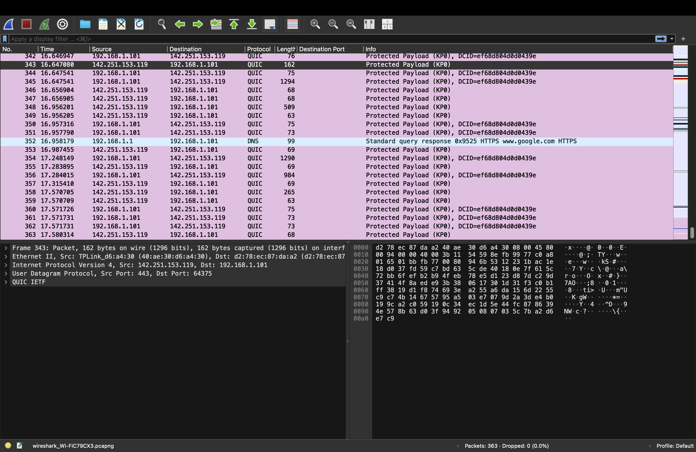
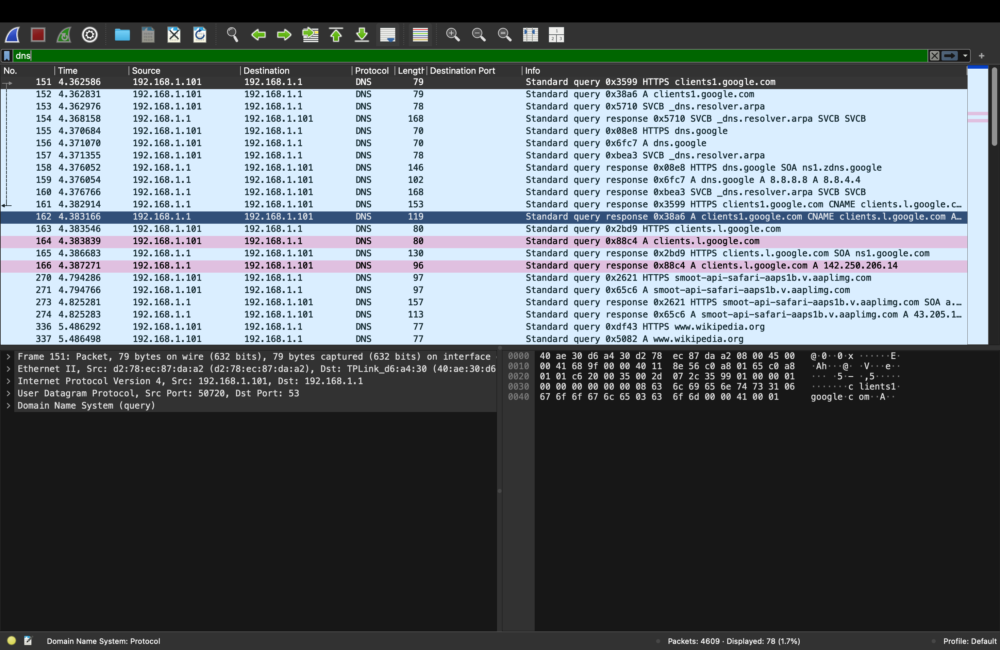
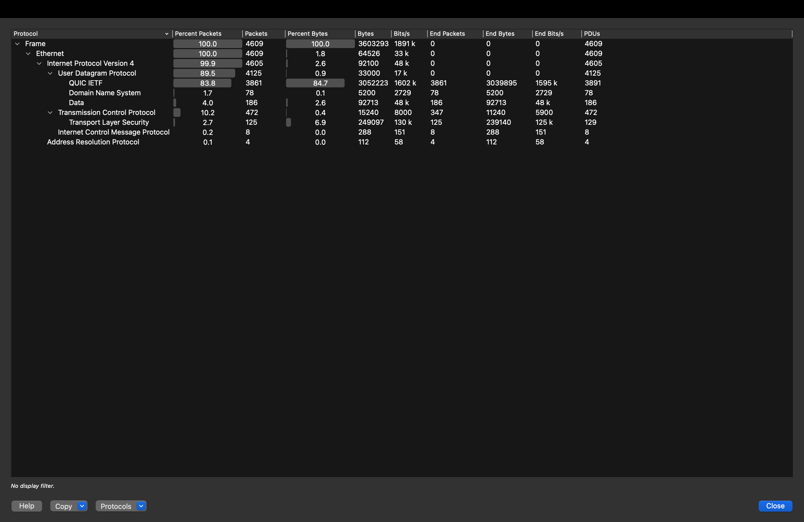
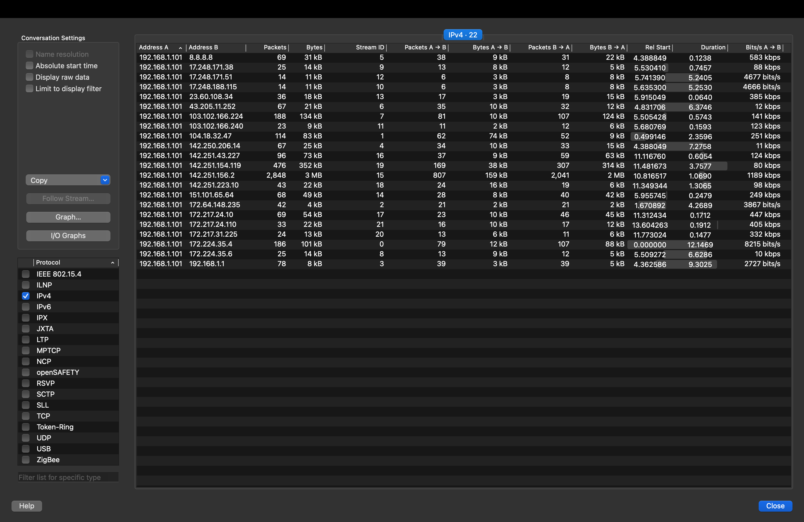

# Network Traffic Investigation

## Objective

The objective of this project is to capture and analyze network traffic using Wireshark and understand how different network protocols communicate.

## Tools Used

- Wireshark
- macOS
- Wi-Fi interface (en0)

## Investigation Performed

1. Captured network traffic using the Wi-Fi interface.
2. Analyzed DNS traffic.
3. Analyzed TCP traffic.
4. Analyzed TLS traffic.
5. Examined the protocol hierarchy.
6. Analyzed network conversations.
7. Examined IPv4 endpoints.
8. Checked the captured traffic for unusual activity.

## Protocols Observed

- DNS
- TCP
- TLS
- IPv4

## Key Findings

- DNS traffic was observed during the capture.
- TCP communication was observed between different endpoints.
- TLS traffic showed encrypted network communication.
- Multiple IPv4 endpoints were involved in the communication.
- Network conversations were examined to understand traffic between endpoints.
- No obvious malicious activity was identified in the captured traffic.

## Screenshots

### Packet Capture

### DNS Analysis

### TCP Analysis

### TLS Analysis

### Protocol Hierarchy

### Conversations

### Endpoints

## Conclusion

This project helped me understand how network traffic can be captured and analyzed using Wireshark. I learned how to identify protocols, examine DNS and TCP communication, understand encrypted TLS traffic, and analyze network endpoints and conversations.